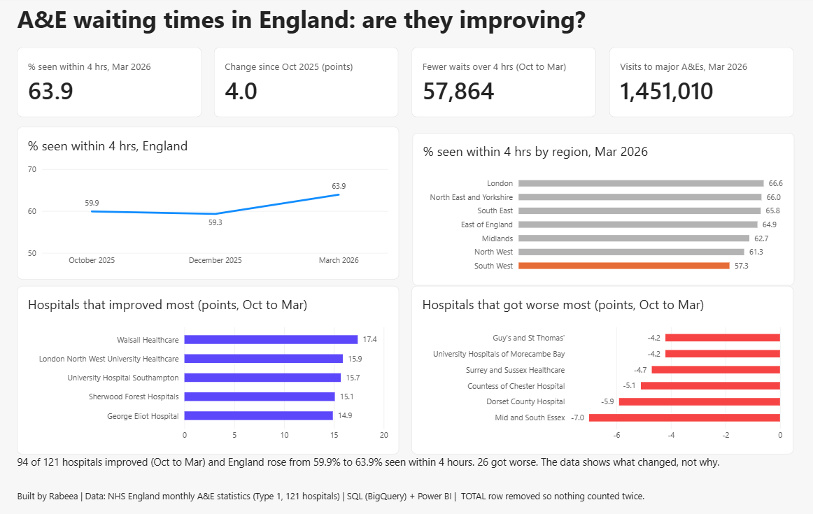

# NHS A&E waiting times: are they improving?

**Question:** Which parts of the NHS are struggling most with A&E waiting times?

## What I found
- England: the share of patients seen within 4 hours rose from **59.9% (Oct 2025)** to **63.9% (Mar 2026)** with almost the same number of visits. That is about 58,000 fewer people waiting over 4 hours.
- **94 of 121 hospitals improved** between Oct 2025 and Mar 2026. 26 got worse and 1 stayed the same.
- The **South West** is the slowest region in March 2026: only 57.3% seen within 4 hours. London is the best at 66.6%.
- Even the best region is far below the long-standing 95% target, so this is a national problem.
- Comparing fairly (long waits per 1,000 visits instead of raw counts) changes the ranking: Countess of Chester has the highest rate of 12+ hour waits for a bed, 143.6 per 1,000.
- 5 of the 10 hospitals with the highest rate of 12+ hour waits are in the North West.

## Data
NHS England monthly A&E Attendances and Emergency Admissions: October 2025, December 2025 and March 2026.
I used **Type 1** departments (major hospital emergency departments, open 24 hours): **121 hospitals**.

## How I checked my work
- The TOTAL row was counted twice at first (my total came out double). I removed it, and my hospital totals match the TOTAL row.
- Some organisations have no Type 1 department, so I excluded them and said so.
- Power BI once added my percentages up to 119.2%. I caught it because a percentage cannot be over 100, and fixed it so each month shows its own value.
- I counted how many hospitals improved before writing "most hospitals improved".

## Limits
- Only three months of data (Oct, Dec, Mar), so this is not a proven trend.
- Changes between months could be seasonal. The data shows what changed, not why.
- The 12+ hour wait column covers all A&E types, but I divided it by Type 1 visits only, so treat per-1,000 figures as a ranking, not an exact rate.

## Tools
SQL (BigQuery) for analysis, Power BI for the dashboard.

## Files
- `dashboard.png`: the dashboard
- `NHS_AE_Dashboard.pdf`: PDF version
- `NHS_AE_Dashboard.pbix`: Power BI file
- `queries.sql`: all SQL queries.
